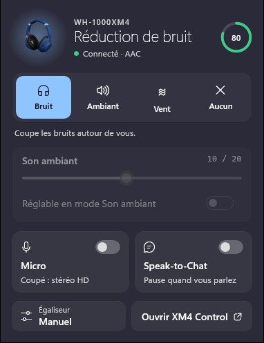
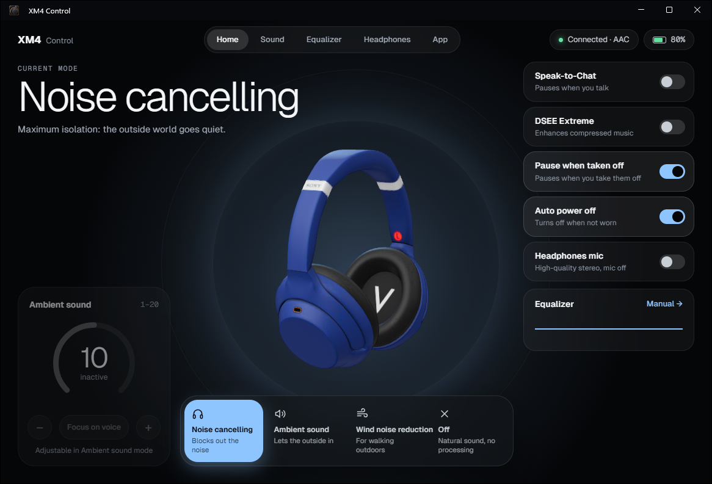

Contrôle du casque **Sony WH-1000XM4** depuis Windows 11, sans l'appli mobile Sony : modes de réduction de bruit, égaliseur, micro et tous les réglages du casque, depuis la zone de notification.

<p>
  
  
</p>

## Fonctionnalités

- **Icône de notification** : une pile façon macOS avec le niveau de batterie du casque, rouge à 20 % et moins, vide et atténuée quand le casque n'est pas connecté. Blanche ou noire selon le thème de la barre des tâches, nette à toutes les échelles d'affichage.
- **Popup au-dessus de l'horloge** (un clic sur l'icône) : mode actuel et batterie, réduction de bruit / son ambiant / vent / désactivé, niveau du son ambiant, bascules Micro et Speak-to-Chat, accès direct à l'égaliseur.
- **Fenêtre principale** (double-clic sur l'icône) : casque en 3D, réglages rapides, pages Son, Égaliseur, Casque et Application.
- **Égaliseur** : préréglages Sony, courbe Clear Bass et 5 bandes à régler à la souris (glisser ou molette).
- **Micro on/off** : coupe le profil « mains libres » de Windows pour que le casque reste en stéréo haute qualité. Fini le son « téléphone » quand Teams ou Discord ouvre le micro.
- **Raccourci global `Ctrl + Alt + N`** : réduction de bruit → son ambiant → désactivé, depuis n'importe quelle appli.
- **Réglages du casque** : optimiseur de réduction de bruit, Speak-to-Chat (sensibilité, délai), DSEE Extreme, pause au retrait, extinction automatique, pavé tactile, guide vocal.
- **Alerte** quand la batterie passe sous 20 %, **lancement au démarrage** de Windows.
- **Ligne de commande** `xm4` pour les scripts.

## Installation

1. Appairer le casque dans *Paramètres > Bluetooth et appareils*.
2. Télécharger `Xm4Control.exe` ci-dessous, le ranger dans un dossier à soi (par exemple `%LOCALAPPDATA%\Programs\XM4 Control`) et le lancer. Rien d'autre à installer : l'exe embarque .NET, et la fenêtre principale utilise WebView2, déjà présent dans Windows 11.
3. Au premier lancement, Windows SmartScreen peut afficher « Windows a protégé votre ordinateur », car l'exe n'est pas signé : *Informations complémentaires > Exécuter quand même*.
4. Windows 11 range les nouvelles icônes dans la zone masquée (flèche `^`). Pour garder la pile visible : *Paramètres > Personnalisation > Barre des tâches > Autres icônes de la barre d'état système*.

L'appli se connecte toute seule au casque dès que Windows le voit connecté. Le lancement au démarrage s'active dans la page Application de la fenêtre principale.

## Utilisation

| Action | Effet |
|---|---|
| Clic sur l'icône | Popup rapide |
| Double-clic sur l'icône | Fenêtre principale |
| Clic droit sur l'icône | Menu : modes, micro, réglages, quitter |
| `Ctrl + Alt + N` | Mode suivant |
| Relancer l'exe | Ouvre la fenêtre principale de l'appli déjà lancée |

Fermer la fenêtre principale libère sa mémoire : l'appli reste dans la zone de notification.

## Ligne de commande

`xm4.exe` est indépendant de l'appli :

```text
xm4 status                 état du casque
xm4 nc                     réduction de bruit
xm4 ambient [1-20] [voix]  son ambiant
xm4 wind | off             réduction du vent / désactivé
xm4 eq BassBoost           préréglage d'égaliseur
xm4 dsee|s2c|pause|autooff|touch|voice on|off
xm4 mic off                stéréo sans micro (mic on pour revenir)
xm4 list                   appareils Bluetooth appairés et état de connexion
```

Le casque n'accepte qu'une connexion de contrôle à la fois : quand l'appli tourne, la ligne de commande ne peut pas s'y connecter, sauf `xm4 mic` et `xm4 list` qui passent par Windows.

## Bon à savoir

- **Micro coupé, le casque ne se reconnecte plus tout seul au PC** : il se reconnecte par le profil « mains libres », que l'option coupe. Le reconnecter depuis les paramètres rapides (*Bluetooth > WH-1000XM4*) ou *Paramètres > Bluetooth et appareils*.
- **Le casque ne s'utilise pas pendant la charge** : il se déconnecte du PC, et l'icône affiche la pile vide.
- Testé avec un WH-1000XM4 en firmware 2.9.0. L'appli ne cherche que ce modèle : le WH-1000XM5 et les autres casques Sony ne sont pas pris en charge.
- En cas de souci, `Xm4Control.exe --log` écrit les échanges avec le casque dans `%LOCALAPPDATA%\Xm4Control\trace.log`.

## Mise à jour

Quitter l'appli (clic droit sur l'icône > *Quitter*), remplacer `Xm4Control.exe` par la nouvelle version et le relancer. Les réglages sont conservés.

## Désinstallation

1. Si le micro est coupé, le réactiver d'abord (popup, bascule Micro) : sinon le profil « mains libres » reste désactivé dans Windows.
2. Désactiver le lancement au démarrage (page Application), puis quitter l'appli.
3. Supprimer l'exe, ainsi que les dossiers `%APPDATA%\Xm4Control` (réglages) et `%LOCALAPPDATA%\Xm4Control` (données de la fenêtre principale).

## Fichiers

| Fichier | Contenu |
|---|---|
| `Xm4Control.exe` | L'application (environ 40 Mo, autonome) |
| `xm4.exe` | La ligne de commande (environ 38 Mo, autonome) |

Windows 11, 64 bits. Projet indépendant sous licence MIT, non affilié à Sony.
