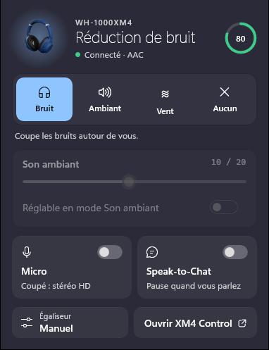
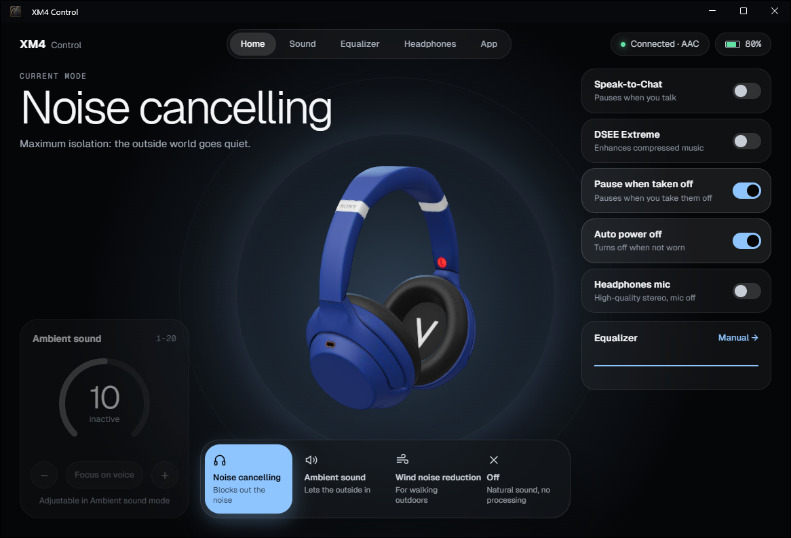

<p align="center"></p>

# XM4 Control

**English** · [Français](README.fr.md)

Control your **Sony WH-1000XM4** headphones from Windows 11: noise cancelling, ambient sound, equalizer, battery
level and every headset setting, right from the system tray, without the Sony mobile app. An unofficial desktop
alternative to Sony Headphones Connect (now Sound Connect), which only exists on phones.

> The app's interface is in French.

<p>
  
  
</p>

- **Stereo during calls**: the Mic switch turns off the Windows Hands-Free profile, so the headphones stay in
  high-quality stereo instead of dropping to mono "phone call" sound when Teams, Discord or Zoom opens the
  microphone (use your PC or webcam microphone instead)
- **Tray flyout above the clock**: current mode and battery, noise cancelling / ambient sound / wind / off,
  ambient sound level, Mic and Speak-to-Chat switches, quick access to the equalizer
- **Main window**: current mode and 3D headset, quick settings, Sound, Equalizer, Headset and App pages
- **Global shortcut `Ctrl + Alt + N`**: noise cancelling → ambient sound → off, from any app
- **Equalizer**: Sony presets, Clear Bass and 5 bands you adjust with the mouse (drag or scroll wheel)
- NC Optimizer, Speak-to-Chat (sensitivity, timeout), DSEE Extreme, pause when taken off, automatic power off,
  touch panel, voice guidance, wind noise reduction
- Battery level in the tray icon, alert when it drops to 20 %, start with Windows
- Native Windows 11 flyout in WinUI 3 (Acrylic, follows the system light/dark theme); main window in HTML/CSS
  rendered by WebView2 (dark theme, 3D headset)
- `xm4` command-line tool for scripts

## Installation

Download `Xm4Control.exe` from the [Releases](https://github.com/ilyaszk/xm4-control/releases) and run it.
Nothing else to install: the exe bundles .NET, and the main window uses WebView2, which ships with Windows 11.
On first launch, Windows SmartScreen may show "Windows protected your PC" (the exe isn't signed):
*More info > Run anyway*.

Pair the headphones in *Settings > Bluetooth & devices*; the app connects to them on its own as soon as they are
on. Windows 11 puts new icons in the hidden area (the `^` arrow): to keep this one visible, go to
*Settings > Personalization > Taskbar > Other system tray icons*.

## Usage

- **Click** the icon (a battery showing the headset's charge, red at 20 % and below, empty and dimmed when the
  headphones aren't connected): quick flyout. **Double-click**: main window.
  **Right-click**: menu (modes, mic, settings, quit).
- **Running the exe again** (Start menu, double-click) opens the main window of the app already running.
- Closing the main window frees its memory; the app stays in the tray.
- `Xm4Control.exe --log` writes the frames exchanged with the headphones to `%LOCALAPPDATA%\Xm4Control\trace.log`.

**Command line** (`xm4.exe`, also in the Releases):

```text
xm4 status                 headset status
xm4 nc                     noise cancelling
xm4 ambient [1-20] [voix]  ambient sound (level, voix = focus on voice)
xm4 wind | off             wind noise reduction / off
xm4 eq BassBoost           equalizer preset
xm4 dsee|s2c|pause|autooff|touch|voice on|off
xm4 mic off                stereo without the headset mic (mic on to undo)
xm4 list                   paired Bluetooth devices and connection state
xm4 raw 6602 -v            debug: raw payload, -v prints the frames
```

The headphones accept only one control connection per PC: while the app is running, the CLI can't connect to
them (except `xm4 mic` and `xm4 list`, which go through Windows).

## How it works

### The headphones: Sony "MDR" protocol v1 over RFCOMM

The XM4 exposes a proprietary classic Bluetooth RFCOMM service, UUID `96CC203E-5068-46AD-B32D-E316F5E069BA`
(the one the Sony app uses). The app connects to it with a Winsock `AF_BTH` / `BTHPROTO_RFCOMM` socket; Windows
finds the channel through SDP from the UUID.

Frame:

```text
3E | type | sequence | length (4 bytes, big endian) | payload | checksum | 3C
```

- `type`: `0x01` ACK, `0x0C` command, `0x0E` command (second set: voice guidance).
- `checksum`: sum modulo 256 of the bytes between `3E` and the checksum.
- Escaping: `3C`, `3D`, `3E` inside the frame become `3D` followed by the byte `& 0xEF`.
- Every message is acknowledged. An ACK carries the sequence `1 - n`; the next command reuses the sequence of the
  last ACK received. The headphones also send unsolicited notifications (NC/AMB button, battery…).

The first byte of the payload is the command, in groups of four: GET (`n`), RET (`n+1`), SET (`n+2`),
NOTIFY (`n+3`):

| Function | GET | SET (example) |
|---|---|---|
| Init (4-byte reply = protocol v1) | `00 00` | |
| Battery | `10 00` → `11 00 <level> <charging>` | |
| Codec | `18 00` → `19 00 <codec>` | |
| Ambient sound | `66 02` | `68 02 11 02 02 01 00 00` (noise cancelling) |
| Equalizer | `56 01` | `58 01 <preset> 00` |
| DSEE Extreme | `E6 02` | `E8 02 00 <on>` |
| Touch panel | `D6 D1` | `D8 D1 01 <on>` |
| Pause when taken off | `F6 03` | `F8 03 00 <on>` |
| Automatic power off | `F6 04` | `F8 04 01 10 00` (when taken off), `11 00` (never) |
| Speak-to-Chat | `F6 05` | `F8 05 01 <on>` |
| Speak-to-Chat settings | `FA 05` | `FC 05 00 <sensitivity> <voice focus> <timeout>` |
| NC Optimizer | notifications `85 01 00 <step>` | `84 01 00 01` (start), `00` (stop) |
| Voice guidance (type `0x0E`) | `46 01 01` | `48 01 01 <on>` |
| Power off the headphones | | `22 00 01` |

Speak-to-Chat: sensitivity `00` auto, `01` high, `02` low; timeout `00` short, `01` standard, `02` long,
`03` never. NC Optimizer: `01` checking fit, `02` atmospheric pressure, `10` analysing, `11` done.

Ambient sound, `68 02 <effect> 02 <nc> 01 <voice> <level>`: effect `00` off / `11` on;
nc `02` noise cancelling, `01` wind, `00` ambient sound; level 1 to 20 (`0` in noise cancelling).

Quirks seen on an XM4 with firmware 2.9.0:

- Right after connecting, the headphones ignore the first frame: the init is resent every 300 ms.
- Speak-to-Chat replies `F7 05 00 <state>` to the GET and `F9 05 01 <state>` after a SET; `F9 05 02 ..` is a
  different message, ignored.
- The touch panel is the general setting `0xD1`: asked with `D0 D1`, the headphones answer
  `TOUCH_PANEL_SETTING`. They don't expose `0xD2` (used by Gadgetbridge) or `0xD3`, even though `D6 D2` gets a
  reply. Value `01` = enabled, like the other booleans of protocol v1.
- The headphones don't accept several RFCOMM connections in quick succession: leave a few seconds between two
  CLI calls.

### The mic: the Windows Hands-Free profile

This isn't a headset command. Windows connects two profiles: A2DP (stereo, no mic) and HFP (hands-free, mono with
mic). As soon as an app opens the microphone, Windows switches to HFP and the sound gets worse. The app turns the
headset's HFP service (`0000111E-…`) on or off with `BluetoothSetServiceState`, like the "Handsfree Telephony"
checkbox in Control Panel. No administrator rights needed. If Windows turns it back on (re-pairing…), the app
turns it off again on the next connection.

The headphones reconnect to the PC through this profile when switched on: with the mic off, they no longer
reconnect on their own. Reconnect them from *Settings > Bluetooth & devices*.

### Sources

- [Gadgetbridge](https://codeberg.org/Freeyourgadget/Gadgetbridge): Android implementation of the Sony protocol
  (`service/devices/sony/headphones`)
- [SonyHeadphonesClient](https://github.com/Plutoberth/SonyHeadphonesClient): the first PC client (archived)
- [omarchy-headphones, PROTOCOL.md](https://raw.githubusercontent.com/ncr/omarchy-headphones/main/PROTOCOL.md):
  captures from a WH-1000XM4

## Development

```text
src/Xm4Control.Core   protocol (frames, commands, decoding), Win32 Bluetooth, RFCOMM client
src/Xm4Control.App    WinUI 3 app (Windows App SDK): flyout, tray icon (H.NotifyIcon)
src/Xm4Control.App/Web  main window in HTML/CSS/JS (WebView2), 3D headset with three.js
src/Xm4Control.Cli    xm4 tool
tests/                protocol tests on captured frames
tools/headset-render  Blender scripts: lightweight 3D model (Web/headset.glb) and fallback image (Web/headset.png)
```

The 3D model and the image are rebuilt with Blender (`winget install BlenderFoundation.Blender`), from the glTF
model downloaded from Sketchfab and unzipped into `docs/3d/src/` (not versioned):

```powershell
$blender = "C:\Program Files\Blender Foundation\Blender 5.2\blender.exe"
& $blender -b -P tools/headset-render/export_web.py -- docs/3d/src/scene.gltf src/Xm4Control.App/Web/headset.glb
& $blender -b -P tools/headset-render/render.py -- docs/3d/src/scene.gltf src/Xm4Control.App/Web/headset.png
```

The main window page also opens in a browser, with sample data, to work on the design (serve the `Web` folder
over local HTTP: JS modules don't load from `file://`).

Requirements: .NET 10 SDK (`winget install Microsoft.DotNet.SDK.10`). No Visual Studio needed.

```powershell
dotnet build
dotnet test
```

GitHub Actions (`.github/workflows/build.yml`) builds, tests and produces both exes on every push: download them
from the run (artifact `xm4-control`, kept 30 days). To publish a version, change the version in
`Directory.Build.props`, commit, then push a tag with the same number:

```powershell
git tag v2.4.0
git push origin master v2.4.0
```

The action then creates the release with both exes. Its notes list the commits since the previous version,
followed by the description in `.github/release-notes.md`. If the release already exists (notes written by hand),
the action only uploads the exes.

The app is unpackaged (no MSIX), with the Windows App SDK runtime bundled, trimmed and compressed into a single exe
(about 40 MB, web page and 3D model included): its files are extracted to a temporary folder on first launch. To
build the exes locally, as the action does:

```powershell
dotnet publish src/Xm4Control.App -c Release -p:Platform=x64 -r win-x64 -o publish
dotnet publish src/Xm4Control.Cli -c Release -r win-x64 --self-contained -p:PublishSingleFile=true `
  -p:IncludeNativeLibrariesForSelfExtract=true -p:EnableCompressionInSingleFile=true -o publish
```

## License

[MIT](LICENSE). Independent project, not affiliated with Sony.

The 3D headset (and its image) comes from the model
"[SONY headphone WH-1000XM4](https://sketchfab.com/3d-models/sony-headphone-wh-1000xm4-f90f76c75d8143eb97eb49844050aa26)"
by [Chizuko V](https://sketchfab.com/chizuk0), licensed under [CC BY 4.0](http://creativecommons.org/licenses/by/4.0/).
Bundled in `Web/vendor`: [three.js](https://threejs.org) (MIT) and the
[Geist](https://vercel.com/font) font (SIL Open Font License), with their licenses.
