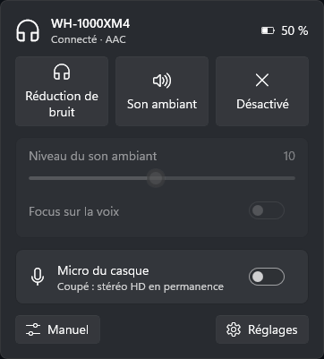
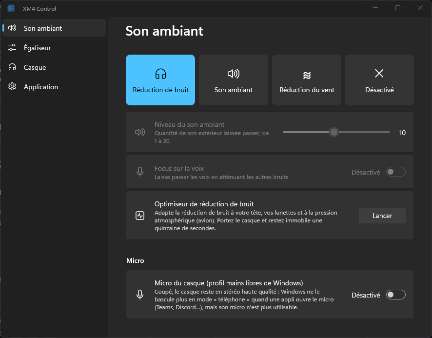

# XM4 Control

Contrôle du casque **Sony WH-1000XM4** depuis Windows, sans l'appli mobile Sony.

<p>
  
  
</p>

- **Popup au-dessus de l'horloge** : réduction de bruit / son ambiant / désactivé, niveau du son ambiant, micro, batterie
- **Micro on/off** : coupe le profil « mains libres » de Windows pour que le casque reste en stéréo haute qualité
  (plus de bascule en son « téléphone » quand Teams ou Discord ouvre le micro)
- **Raccourci global `Ctrl + Alt + N`** : réduction de bruit → son ambiant → désactivé, depuis n'importe quelle appli
- **Égaliseur** : préréglages Sony, courbe Clear Bass + 5 bandes à régler à la souris
- Optimiseur de réduction de bruit, Speak-to-Chat (sensibilité, délai), DSEE Extreme, pause au retrait,
  extinction automatique, pavé tactile, guide vocal, réduction du vent
- Notification quand la batterie passe sous 20 %, lancement au démarrage de Windows
- Interface WinUI 3, celle de Windows 11 (Mica, Acrylic, thème clair/sombre du système)
- Outil en ligne de commande `xm4` pour les scripts

## Installation

Télécharger `Xm4Control.exe` dans les [Releases](https://github.com/ilyaszk/xm4-control/releases) et le lancer.
Rien d'autre à installer : l'exe embarque .NET. Au premier lancement, Windows SmartScreen peut afficher
« Windows a protégé votre ordinateur » (l'exe n'est pas signé) : *Informations complémentaires > Exécuter quand même*.

Le casque doit être appairé dans *Paramètres > Bluetooth et appareils* ; l'appli s'y connecte toute seule dès
qu'il est allumé. Windows 11 range les nouvelles icônes dans la zone masquée (flèche `^`) : pour garder celle-ci
visible, *Paramètres > Personnalisation > Barre des tâches > Autres icônes de la barre d'état système*.

## Utilisation

- **Clic gauche** sur l'icône : popup rapide. **Clic droit** : menu (modes, micro, réglages, quitter).
- La fenêtre Réglages se cache quand on la ferme ; l'appli reste dans la zone de notification.
- `Xm4Control.exe --log` écrit les trames échangées avec le casque dans `%LOCALAPPDATA%\Xm4Control\trace.log`.

**Ligne de commande** (`xm4.exe`, aussi dans les Releases) :

```text
xm4 status                 état du casque
xm4 nc                     réduction de bruit
xm4 ambient [1-20] [voix]  son ambiant
xm4 wind | off             réduction du vent / désactivé
xm4 eq BassBoost           préréglage d'égaliseur
xm4 dsee|s2c|pause|autooff|touch|voice on|off
xm4 mic off                stéréo sans micro (mic on pour revenir)
xm4 raw 6602 -v            debug : payload brut, -v affiche les trames
```

Le casque n'accepte qu'une connexion de contrôle par PC : quand l'appli tourne, la CLI ne peut pas se
connecter au casque (sauf `xm4 mic` et `xm4 list`, qui passent par Windows).

## Comment ça marche

### Le casque : protocole Sony « MDR » v1 sur RFCOMM

Le XM4 expose un service Bluetooth classique RFCOMM propriétaire, UUID `96CC203E-5068-46AD-B32D-E316F5E069BA`
(c'est lui qu'utilise l'appli Sony). On s'y connecte avec un socket Winsock `AF_BTH` / `BTHPROTO_RFCOMM` ;
Windows retrouve le canal par SDP à partir de l'UUID.

Trame :

```text
3E | type | séquence | longueur (4 octets, big endian) | payload | checksum | 3C
```

- `type` : `0x01` ACK, `0x0C` commande, `0x0E` commande (2e jeu : guide vocal).
- `checksum` : somme modulo 256 des octets entre `3E` et le checksum.
- Échappement : `3C`, `3D`, `3E` dans la trame deviennent `3D` suivi de l'octet `& 0xEF`.
- Chaque message est acquitté. Un ACK porte la séquence `1 - n` ; la commande suivante réutilise la séquence
  du dernier ACK reçu. Le casque envoie aussi des notifications spontanées (bouton NC/AMB, batterie…).

Le premier octet du payload est la commande, par quadruplets GET (`n`), RET (`n+1`), SET (`n+2`), NOTIFY (`n+3`) :

| Fonction | GET | SET (exemple) |
|---|---|---|
| Init (réponse de 4 octets = protocole v1) | `00 00` | |
| Batterie | `10 00` → `11 00 <niveau> <en charge>` | |
| Codec | `18 00` → `19 00 <codec>` | |
| Son ambiant | `66 02` | `68 02 11 02 02 01 00 00` (réduction de bruit) |
| Égaliseur | `56 01` | `58 01 <préréglage> 00` |
| DSEE Extreme | `E6 02` | `E8 02 00 <on>` |
| Pavé tactile | `D6 D1` | `D8 D1 01 <on>` |
| Pause au retrait | `F6 03` | `F8 03 00 <on>` |
| Extinction automatique | `F6 04` | `F8 04 01 10 00` (quand on ne le porte plus), `11 00` (jamais) |
| Speak-to-Chat | `F6 05` | `F8 05 01 <on>` |
| Réglages Speak-to-Chat | `FA 05` | `FC 05 00 <sensibilité> <focus voix> <délai>` |
| Optimiseur de réduction de bruit | notifications `85 01 00 <étape>` | `84 01 00 01` (lancer), `00` (arrêter) |
| Guide vocal (type `0x0E`) | `46 01 01` | `48 01 01 <on>` |
| Éteindre le casque | | `22 00 01` |

Speak-to-Chat : sensibilité `00` auto, `01` élevée, `02` faible ; délai `00` court, `01` standard, `02` long,
`03` jamais. Optimiseur : `01` vérification du port, `02` pression atmosphérique, `10` analyse, `11` terminé.

Son ambiant, `68 02 <effet> 02 <nc> 01 <voix> <niveau>` : effet `00` éteint / `11` actif ;
nc `02` réduction de bruit, `01` vent, `00` son ambiant ; niveau de 1 à 20 (`0` en réduction de bruit).

Particularités constatées sur un XM4 en firmware 2.9.0 :

- Juste après la connexion, le casque ignore la première trame : l'init est réémise toutes les 300 ms.
- Speak-to-Chat répond `F7 05 00 <état>` au GET et `F9 05 01 <état>` après un SET ; `F9 05 02 ..` est un
  autre message, ignoré.
- Le pavé tactile est le réglage général `0xD1` : interrogé par `D0 D1`, le casque répond
  `TOUCH_PANEL_SETTING`. Il n'expose pas `0xD2` (utilisé par Gadgetbridge) ni `0xD3`, même si `D6 D2` reçoit
  une réponse. Valeur `01` = activé, comme les autres booléens du protocole v1.
- Le casque n'accepte pas plusieurs connexions RFCOMM rapprochées : laisser quelques secondes entre deux
  appels de la CLI.

### Le micro : profil mains libres de Windows

Ce n'est pas une commande du casque. Windows connecte deux profils : A2DP (stéréo, sans micro) et HFP
(mains libres, mono avec micro). Dès qu'une appli ouvre le micro, Windows bascule sur HFP et le son se dégrade.
L'appli active ou désactive le service HFP (`0000111E-…`) du casque avec `BluetoothSetServiceState`,
comme la case « Téléphonie mains libres » du Panneau de configuration. Pas besoin des droits administrateur.
Si Windows le réactive (réappairage…), l'appli le recoupe à la connexion suivante.

### Sources

- [Gadgetbridge](https://codeberg.org/Freeyourgadget/Gadgetbridge) : implémentation Android du protocole Sony
  (`service/devices/sony/headphones`)
- [SonyHeadphonesClient](https://github.com/Plutoberth/SonyHeadphonesClient) : premier client PC (archivé)
- [omarchy-headphones, PROTOCOL.md](https://raw.githubusercontent.com/ncr/omarchy-headphones/main/PROTOCOL.md) :
  captures sur un WH-1000XM4

## Développement

```text
src/Xm4Control.Core   protocole (trames, commandes, décodage), Bluetooth Win32, client RFCOMM
src/Xm4Control.App    appli WinUI 3 (Windows App SDK), Community Toolkit pour les cartes de réglages,
                      H.NotifyIcon pour l'icône de notification
src/Xm4Control.Cli    outil xm4
tests/                tests du protocole sur des trames capturées
```

Prérequis : SDK .NET 10 (`winget install Microsoft.DotNet.SDK.10`). Pas besoin de Visual Studio.

```powershell
dotnet build
dotnet test
```

Publier une version (la version est dans `Directory.Build.props`). L'appli est non empaquetée (pas de MSIX),
avec le runtime Windows App SDK embarqué, élaguée et compressée en un seul exe (environ 35 Mo) : ses fichiers sont
extraits dans un dossier temporaire au premier lancement.

```powershell
dotnet publish src/Xm4Control.App -c Release -p:Platform=x64 -r win-x64 -o publish
dotnet publish src/Xm4Control.Cli -c Release -r win-x64 --self-contained -p:PublishSingleFile=true `
  -p:IncludeNativeLibrariesForSelfExtract=true -p:EnableCompressionInSingleFile=true -o publish
gh release create v2.0.0 publish/Xm4Control.exe publish/xm4.exe --title "XM4 Control 2.0.0" --notes "..."
```

## Licence

[MIT](LICENSE). Projet indépendant, non affilié à Sony.
